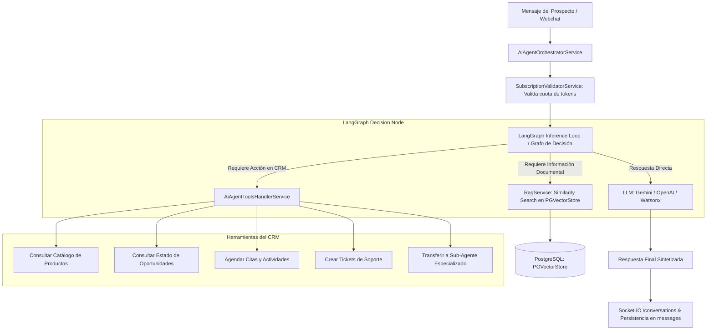

# 🤖 Motor de Inteligencia Artificial, RAG & LangGraph

## 1. Visión General de la Arquitectura de IA
CRM TIBS API incorpora una capa cognitiva de última generación diseñada para automatizar la atención comercial y soporte a través de agentes inteligentes conversacionales. El sistema integra **LangChain**, **LangGraph**, modelos de lenguaje avanzados (Google Gemini, OpenAI, IBM Watsonx) y una base de datos vectorial en PostgreSQL con **PGVectorStore** para recuperación contextual aumentada (RAG).

---

## 2. Orquestador Agéntico (`AiAgentOrchestratorService` & `AiAgentToolsHandlerService`)

### 2.1. Bucle de Inferencia con LangGraph
En lugar de depender de prompts estáticos, el agente opera mediante un grafo de estados computacional (**LangGraph**):
1. **Nodo de Análisis:** Analiza la intención del mensaje del cliente y el historial conversacional.
2. **Nodo de Herramientas (Tools Calling):** Si el modelo detecta la necesidad de ejecutar una acción en el CRM o consultar datos corporativos, genera una llamada a función estructurada.
3. **Nodo de Ejecución:** `AiAgentToolsHandlerService` ejecuta la acción de forma segura dentro del esquema del inquilino activo.
4. **Nodo de Síntesis:** El modelo incorpora los datos retornados por las herramientas y redacta una respuesta coherente con el tono definido en `AiAgentConfig`.

### 2.2. Catálogo de Herramientas Disponibles para el Agente:
* `consult_product_catalog`: Consulta productos, precios vigentes y características técnicas con soporte RAG.
* `createOpportunity` / `modifyOpportunity`: Registra o edita cotizaciones y oportunidades comerciales.
* `createActivity`: Agenda citas, llamadas o reuniones en la agenda del ejecutivo.
  * **Validación Obligatoria de Correo:** Si la actividad se relaciona a un contacto, el sistema valida estrictamente que cuente con correo electrónico asignado en el CRM. Si el contacto no tiene correo, el agente solicita amablemente el correo al cliente antes de agendar y lo persiste con `updateContact`. Queda prohibido llamar a `createActivity` sin correo.
* `checkAvailability`: Valida disponibilidad de agenda sin colisiones previo a la creación de actividades.
* `updateContact` / `registerContact`: Identifica y persiste datos de prospectos y clientes.
* `createTicket`: Levanta un ticket de soporte técnico si el usuario reporta una falla o queja.
* `requestHumanHandoff`: Deriva la conversación a un ejecutivo especializado y desactiva el bot.

## 3. Pipeline de RAG y Búsqueda Vectorial (`src/rag`)

### 3.1. Ingestión y Procesamiento de Documentos (`POST /api/rag/upload`)
1. **Recepción:** El usuario sube manuales técnicos, catálogos de servicios o políticas en formato PDF.
2. **Extracción:** Se extrae el texto puro utilizando `pdf-parse`.
3. **Chunking Semántico:** `RecursiveCharacterTextSplitter` divide el texto en fragmentos óptimos (chunk size: 1000 caracteres, chunk overlap: 200) respetando saltos de párrafo y oraciones.
4. **Generación de Embeddings Vectoriales:**
   * El sistema selecciona el modelo configurado por el inquilino:
     * **Google Generative AI:** `text-embedding-004` (vía `@langchain/google-genai`).
     * **OpenAI:** `text-embedding-3-small` (vía `@langchain/openai`).
     * **IBM Watsonx:** Adaptador nativo `CustomWatsonxEmbeddings` que negocia tokens OAuth IAM (`https://iam.cloud.ibm.com/identity/token`) y genera vectores con `ibm/slate-125m-english-rtrvr`.
5. **Persistencia Vectorial:** Los vectores y metadatos se almacenan en la tabla vectorial de PostgreSQL mediante `PGVectorStore`.

### 3.2. Consulta Semántica (`POST /api/rag/query`)
* Ante una duda del cliente, el servicio convierte la pregunta en vector y ejecuta una búsqueda por similitud de coseno (`similaritySearchWithScore`), inyectando los fragmentos documentales más relevantes en el contexto del prompt del agente.

---

## 4. Control de Consumo de Tokens y Cuotas
* Antes y después de cada invocación a los modelos generativos, `SubscriptionValidatorService` calcula el total de tokens de entrada (`prompt_tokens`) y salida (`completion_tokens`).
* Actualiza el consumo acumulado del tenant en el periodo y emite el evento `CONVERSATION_EVENTS.TENANT_CONSUMPTION_UPDATED` a través de `EventEmitter2` para actualizar en vivo el indicador de consumo en la interfaz de usuario.

### 🔄 Actualización de Encadenamiento Continuo en Agendamiento (`seguimiento`)
* **Problema Previo:** Al solicitar el correo electrónico al cliente para agendar una cita o actividad, la herramienta `updateContact` ejecutaba con éxito pero el orquestador forzaba una instrucción de respuesta `final_answer` inmediata. Esto provocaba que el bot dijera que procedería a verificar la disponibilidad pero cerraba el turno sin llamar a `checkAvailability` ni a `createActivity`.
* **Solución Implementada:**
  1. En `ai-agent-orchestrator.service.ts`: Se ajustó la inyección de directivas post-ejecución de herramientas para `updateContact` y `registerContact`. Si el cliente ya había expresado su día y horario de preferencia (ej. *"mañana a las 10 am"*), se instruye al subagente a continuar **en ese mismo turno** invocando `checkAvailability` o `createActivity` sin emitir `final_answer` anticipado.
  2. Asimismo, cuando `checkAvailability` devuelve `available: true` y el contacto ya cuenta con correo registrado, se instruye explícitamente a llamar inmediatamente a `createActivity`.
  3. Sincronización en `ai-sub-agent-migration.service.ts` y `tenant-provisioner.service.ts`: Se actualizó el prompt del subagente `seguimiento` en la base de datos para todos los esquemas de tenants activos (`tenant_teter`, etc.) para asegurar el agendamiento fluido de extremo a extremo en una sola interacción.

### 🔔 Regla Estricta: Recordatorios de Actividad Exclusivamente Internos
* **Comportamiento Ajustado:** El recordatorio creado con `createActivity` (`reminderOffsetMinutes`, por defecto 60 minutos antes) es **exclusivamente interno para la agenda y notificaciones del ejecutivo/usuario del CRM**.
* **Directiva Agéntica:** Se incorporó en `ai-agent-orchestrator.service.ts`, `ai-sub-agent-migration.service.ts` y `tenant-provisioner.service.ts` la instrucción explícita que prohíbe terminantemente al Agente de IA prometer o mencionar al cliente en su respuesta final que recibirá un recordatorio una hora antes de la cita. La confirmación al cliente se limita únicamente a informarle la fecha y hora agendada.

### 🛒 Detección Robusta de Productos en Catálogo & Flujo Mandatorio de Confirmación de Cotizaciones (`comercial`)
* **Problema Previo:**
  1. En mensajes multi-producto (ej. *"Prolene 6-0 3 piezas, Nylon 6-0 2 piezas..."*), `queryCubeProducts` filtraba en Cube.dev únicamente por la palabra más larga (`topTerms[0]`), ignorando los demás productos. Además, la consulta no incluía la dimensión `Productos.id`, lo que dejaba `productId` como `undefined` y descartaba las coincidencias en `findProductsFromSemanticLayer`. La eliminación de guiones transformaba calibres como `6-0` o `10-0` en tokens de un solo carácter que eran descartados.
  2. Al solicitar cotización, el agente generaba la oportunidad de inmediato o preguntaba de forma genérica sin confirmar cantidades individuales. Al responder el cliente afirmativamente (*"sí"*), el LLM alucinaba replicando la cantidad del primer producto a todos los productos en el PDF.
* **Solución Implementada:**
  1. **Indexación y Búsqueda Robusta en `ai-agent-tools-handler.service.ts`:**
     - Se añadió `Productos.id` a las dimensiones de consulta en Cube.dev (`dimensions: ['Productos.id', ...]`).
     - Se preservan caracteres alfanuméricos, guiones y barras (`/[^a-z0-9\s\-\/]/g`) para retener medidas como `6-0`, `10-0` y `2/0`.
     - Soporte multi-query en `consult_product_catalog`: si la consulta contiene comas o conjunciones (`y`, `e`), se segmentan las sub-consultas y se combina Cube.dev con fallback por producto hacia PostgreSQL (`findProductsByKeywords`).
  2. **Estructura Libre de Ambigüedad en Schemas (`CreateOpportunitySchema` y `ModifyOpportunitySchema`):**
     - Se incorporó `items: z.array(OpportunityItemSchema)` (`[{ nombre, cantidad, productId? }]`), vinculando de forma unívoca cada producto con su cantidad sin desfases entre arrays.
  3. **Directiva Agéntica Mandatoria de Confirmación Previa (`ai-sub-agent-migration.service.ts` & `tenant-provisioner.service.ts`):**
     - **Prohibición Estricta:** Se prohíbe terminantemente al sub-agente `comercial` invocar `createOpportunity` o generar cotizaciones sin confirmación previa del cliente.
     - **Desglose Obligatorio:** El agente debe consultar primero el catálogo con `consult_product_catalog` y responder mediante `final_answer` desglosando cada producto identificado con su cantidad detectada y su precio unitario.
     - **Bucle de Corrección:** Si el cliente modifica o corrige cualquier dato, el agente actualiza los valores y vuelve a solicitar confirmación.
     - **Confirmación Final:** Solo tras una respuesta afirmativa explícita del cliente (*"sí"*, *"correcto"*, *"adelante"*), el agente ejecuta `createOpportunity` enviando los `items` confirmados.
  4. **Auto-Sincronización en Tenants Activos:** Se sincroniza la actualización del prompt comercial en la tabla `ai_sub_agents` en todos los esquemas de tenants activos en PostgreSQL.

### 🎯 Resolución Exacta de Productos y Calibres en Cotizaciones PDF
* **Problema Identificado:**
  Al confirmar la cotización de múltiples productos con calibres o variantes similares (ej. *"Nylon 6-0 2 piezas y Nylon 10-0 5 piezas"*), el PDF generado mostraba productos incorrectos (ej. *"Nylon 3-0 5 piezas"*):
  1. `findProductsFromSemanticLayer` delegaba directamente en `queryCubeProducts`, el cual consultaba Cube.dev filtrando únicamente por la palabra más larga (`'nylon'`). Cube.dev retornaba una lista arbitraria de todos los calibres disponibles (Nylon 3-0, Nylon 4-0, etc.) sin ningún orden de relevancia o coincidencia respecto al calibre solicitado (`6-0`, `10-0`).
  2. `createOpportunity` tomaba ciegamente `matched[0].id` para cada ítem. Por tanto, tanto *"Nylon 6-0"* como *"Nylon 10-0"* se mapeaban al primer resultado del catálogo (`Nylon 3-0`), sobrescribiendo la cantidad de uno con el otro y eliminando las variantes correctas.
  3. En `consult_product_catalog`, las respuestas de texto no exponían el `ID del Producto (UUID)`, impidiendo al LLM enviar directamente el `productId` unívoco en `items`.
* **Solución Implementada:**
  1. **Algoritmo de Ranking de Relevancia (`rankProductsByRelevance`):**
     - En `ai-agent-tools-handler.service.ts`, se implementó un motor de puntuación semántica que evalúa:
       - Coincidencia exacta de nombre (+10,000 pts).
       - Coincidencia de subcadena (+5,000 pts).
       - Coincidencia de palabras clave y conjunto completo (+1,000 pts).
       - **Validación Estricta de Calibre/Medida:** Detección de patrones de medida/calibre (`6-0`, `10-0`, `3-0`, `5-0`, etc.). Si el producto coincide en el calibre exacto recibe +3,000 pts; si presenta un calibre contradictorio es penalizado severamente (-5,000 pts).
  2. **Búsqueda Directa en Base de Datos con Fallback a Cube.dev:**
     - `findProductsFromSemanticLayer` consulta prioritariamente PostgreSQL mediante `findProductsByKeywords` y ordena los resultados con `rankProductsByRelevance`. De esta forma, *"Nylon 6-0"* y *"Nylon 10-0"* se resuelven de inmediato a sus IDs exactos en milisegundos.
  3. **Exposición del UUID en Catálogo y Schemas:**
     - `consult_product_catalog` ahora expone explícitamente `ID del Producto (UUID): <uuid>` en los bloques informativos de Cube.dev y de base de datos.
     - Se actualizó el prompt del subagente comercial en `tenant-provisioner.service.ts` y `ai-sub-agent-migration.service.ts` para que incluya el `productId` en `items: [{ productId: '...', nombre: '...', cantidad: ... }]`.

  4. **Flexibilidad en Validación de `productId` (Zod Schema):**
     - En `OpportunityItemSchema`, se flexibilizó la validación de `productId` (`z.string().optional()`) para evitar que si el modelo LLM envía el nombre del producto en lugar de un UUID (ej. `{"productId": "Prolene 6-0"}`), Zod no rechace la ejecución de la herramienta con `Invalid UUID`.
     - En `AiAgentToolsHandlerService`, se incorporó validación segura mediante regex UUID (`isValidUuid`). Si `productId` no es un UUID válido, se toma como texto de búsqueda hacia `findProductsFromSemanticLayer`, resolviendo de forma infalible el producto correcto.

### 📊 Desglose de Inferencia Multietapa y Auditoría Semántica de Tokens (`router` vs `subagent`)
* **Ciclo de Ejecución en 2 Etapas por Mensaje:**
  Cada mensaje entrante procesado por `AiAgentOrchestratorService.processIncomingMessage` ejecuta dos llamadas HTTP independientes al LLM subyacente (IBM WatsonX, Google Gemini o OpenAI):
  1. **Etapa 1 — Enrutador (`router`):** Invocación de clasificación rápida donde el modelo analiza la intención del cliente y el catálogo de subagentes activos, devolviendo un JSON con la ruta seleccionada (`comercial`, `seguimiento`, `soporte`, `general`). Consumo típico: ~1,000 - 1,500 tokens.
  2. **Etapa 2 — Subagente Especializado (`subagent` / `subagent_<route>`):** Invocación profunda con el system prompt del subagente seleccionado, conocimiento RAG, herramientas del CRM (catálogo, disponibilidad, cotizaciones) e historial conversacional. Consumo típico: ~3,000 - 5,000 tokens.
* **Auditoría Semántica en `transaction_history`:**
  - Anteriormente, ambas transacciones persistían con el nombre genérico del proveedor (`watsonx_execution`, `gemini_execution`), lo que en la interfaz de usuario se mostraba como dos filas idénticas para una misma interacción.
  - Se configuró la propagación del paso semántico en `AiAgentOrchestratorService.recordTokenConsumption`: el campo `action_name` guarda de manera diferenciada `'router'`, `'subagent_<route>'`, `'rescue'` o `'conversation_summary'`, permitiendo que el panel de auditoría (`AiConsumptionSection`) muestre badges legibles como *\"Atención Inicial & Enrutamiento\"* y *\"Asesor Comercial / Respuesta del Asistente\"*.

### 📦 Consolidación Atómica de Tokens por Mensaje (`TurnTokenAccumulator`)
* **Problema Previo:** Cada llamada intermedia (Router, Subagente, Rescate) registraba de inmediato una transacción individual en `transaction_history`. Esto saturaba el historial con múltiples registros de segundos de diferencia para un único mensaje del usuario (ej. 1,377 tokens para Router y 4,159 tokens para Subagente).
* **Solución Implementada:**
  1. Se introdujo `TurnTokenAccumulator` en `ConsumptionAuditContext` con contadores en memoria (`promptTokens`, `completionTokens`, `totalTokens`, `steps: string[]`, `models: string[]`).
  2. Al procesar mensajes entrantes (`AiAgentOrchestratorService.processIncomingMessage` y `WebchatService.processQuery`), las llamadas internas al LLM acumulan su consumo en el acumulador en lugar de escribir de inmediato en la base de datos.
  3. En el bloque `finally` de la interacción, se ejecuta `commitTurnConsumption`, persistiendo **un único registro consolidado en `transaction_history`** con la suma exacta de recursos (`prompt_tokens`, `completion_tokens`, `total_tokens`), etiquetado con la acción del subagente resolutivo (ej. `subagent_comercial`, `subagent_ventas`) y registrando en `metadata.steps` la traza de pasos (`['router', 'subagent']`).

### 🕒 Desacoplamiento de Fecha/Hora y Resolución Temporal AI-First (`WebchatActionExecutorService` & `parseNaturalDate`)
* **Problema Identificado en Producción:**
  - Al solicitar acciones en lenguaje natural como *"crear recordatorio para llamar a javier flores el lunes 12 Octubre a las 10 am"*, el sistema programaba la actividad a las *12:00 p.m.* (o con horas alteradas).
  - **Causa Raíz 1 (Colisión Numérica):** En `parseNaturalDate`, la expresión regular de meses requería obligatoriamente la preposición *"de"* (`de\s+(enero|...)`). Al omitirse (`12 Octubre`), el día numérico (`12`) no era enmascarado y la expresión regular de hora capturaba el primer número suelto (`12`) como la hora del evento en lugar de `10 am`.
  - **Causa Raíz 2 (Truncado en Flujos de Rescate y Multi-Turno):** En `extractBasicActionParams` y `mergeHistoryContext`, los regex truncaban cadenas como `el lunes 12`, descartando el segmento de hora.
  - **Causa Raíz 3 (Desfase UTC vs Tenant en `checkAvailability`):** La validación de disponibilidad y generación de slots libres usaba `Date.setHours` sobre la hora local de Node.js (UTC en contenedores de producción), desfasando el rango de agenda respecto a la zona horaria del tenant (`America/Mexico_City`).
* **Solución Implementada:**
  1. **Arquitectura AI-First con Extracción Desacoplada:**
     - En `WebchatPromptBuilderService` (`buildRouterPrompt`), se instruye al modelo a extraer `fecha` (`YYYY-MM-DD` resuelta con el contexto actual) y `hora` (`HH:mm`) de forma desacoplada y unívoca.
  2. **Parser Temporal Resiliente (`parseNaturalDate`):**
     - En `WebchatActionExecutorService`, `parseNaturalDate(dateInput, timeInput?)` procesa la hora de forma prioritaria e independiente (`HH:MM`, `a las X`, `am/pm`, `de la tarde`), eliminando ambigüedades con números de día.
     - Detección flexible de meses con o sin preposición (*"12 Octubre"*, *"12 de Octubre"*, abreviaturas) y días de la semana (`viernes 16`), sin generar falsos positivos con frases horarias (*"de la tarde"*).
     - Corrección del diccionario de días de la semana (`dayMap`) alineado con `Date.getDay()`.
  3. **Alineación Estricta de Zona Horaria en `checkAvailability`:**
     - Se migraron los límites de inicio y fin de jornada y la generación de candidatos a `buildDateInTz`, operando siempre en la zona horaria del tenant (`process.env.NOTIFICATION_TIMEZONE || 'America/Mexico_City'`).
  4. **Desacoplamiento en Reprogramaciones (`handleModifyActivity`):**
     - Se separó estrictamente `targetTime`/`targetDate` (hora/fecha original a buscar) de `newTime`/`newDate` (nueva hora/fecha), previniendo sobrescrituras involuntarias en flujos de modificación de actividades.

##### 🛡️ Validación Antialucinación de Valores Requeridos y Auditoría de Logs AI-First en Actividades

* **Problema Identificado en Producción:**
  - Al solicitar la creación de actividades sin fecha ni hora explícita (ej. *"crea una llamada para el cliente miguel santos"*), el LLM tomaba la fecha y el minuto exacto actual del encabezado contextual (`[USUARIO ACTUAL]`) y generaba `"fecha": "YYYY-MM-DD", "hora": "HH:mm"`, agendando la actividad inmediatamente en el CRM.
  - Al procesar la acción, la consola mostraba `[WebChat - Router Classification] [AI-FIRST]` pero inmediatamente en el ejecutor `[WebChat - Action Executor] [FALLBACK HEURISTICO]`.
* **Causa Raíz:**
  1. **Alucinación de Fecha/Hora:** El prompt del orquestador indicaba un valor por defecto para la hora (`default "10:00"`) y no prohibía explícitamente asumir la fecha actual. Al recibir parámetros completos por alucinación, `handleCreateActivity` no detectaba la ausencia de fecha.
  2. **Discrepancia en Logs (`[FALLBACK HEURISTICO]`):** En `WebchatQueryPlannerService`, el LLM genera `thought` en la raíz del JSON, por lo que `actionPlan.thought` quedaba `undefined`. En `WebchatActionExecutorService`, `const isActionAiFirst = !!(actionPlan.thought && !actionPlan.thought.includes('Recuperación'))` evaluaba a `false` por el valor `undefined`, registrando falsamente fallback heurístico.
* **Solución Implementada:**
  1. **Propagación Integral de Intención (`thought`):** En `WebchatQueryPlannerService`, si `actionPlan.thought` no está definido, se propaga automáticamente `parsed.thought`. En `WebchatActionExecutorService`, se evalúa `!actionPlan.thought?.includes('Recuperación')` garantizando la coherencia del log `[AI-FIRST]`.
  2. **Directiva Estricta en Prompt (`buildRouterPrompt`):** Instrucción explícita prohibiendo inventar fecha u hora para actividades si no fueron provistas por el usuario, omitiéndolas para forzar la solicitud de datos requeridos.
  3. **Guardrail Determinista Antialucinación (`hasTemporalReference`):** En `handleCreateActivity`, si la consulta del usuario y su historial reciente no contienen referencias temporales válidas (días relativos, días de la semana, meses contextualizados u horas), se descartan los parámetros temporales alucinados y se solicita de forma obligatoria la fecha y hora.

* **Resolución Semántica y Catálogo Dinámico de Tipos de Actividad en Agenda (`TiposActividad.nombre`):**
  - **Problema Inicial:** Consultas analíticas como *"listado general de citas de hace 2 semanas"* provocaban que el sub-agente de Actividades interpretara la palabra "citas" como un tipo de actividad específico, inyectando el filtro `TiposActividad.nombre = 'Cita'`. Al no existir dicho valor en el catálogo de base de datos (`Llamada`, `Reunión`, `Demostración`, `Visita`, `Correo`), Cube.dev devolvía 0 filas a pesar de existir actividades agendadas en dicho periodo.
  - **Evolución Multi-Tenant (Soporte para Tipo "Cita" Dinámico):** Si un inquilino/tenant crea un tipo de actividad personalizado llamado `"Cita"` en `tbltypeactivities`, el sistema no debe bloquear ni descartar el filtro.
  - **Solución Dinámica Multi-Tenant Implementada:**
    1. **Consulta en Tiempo de Ejecución (`WebchatActionExecutorService.getActiveActivityTypeNames`):** Se consulta la tabla `tbltypeactivities` con `blnstatus = true` en el esquema PostgreSQL del tenant activo (`TenantContextService`).
    2. **Inyección Dinámica en Prompt (`WebchatPromptBuilderService`):** El sub-agente de Actividades recibe la lista real de tipos configurados en el tenant. Si el tenant tiene configurado `"Cita"`, se le instruye explícitamente a filtrar por `TiposActividad.nombre = 'Cita'`. Si el tenant NO lo tiene configurado, se instruye que *"citas"* es un término genérico de agenda y no debe filtrarse por tipo.
    3. **Sanitización Contextual por Tenant (`WebchatSecurityService`):** En `sanitizeFilterList`, `TiposActividad.nombre` se valida dinámicamente contra los tipos activos reales del tenant (`validActivityTypes`): si coincide (insensible a acentos/mayúsculas/plural), se preserva y normaliza; si NO coincide con ningún tipo del tenant, se descarta para evitar devolver 0 filas vacías en Cube.dev.

### 📅 Validación Bidireccional de Disponibilidad de Agenda (Asesor + Cliente en `checkAvailability`)

* **Problema Identificado en Producción:**
  - Al solicitar agendar una actividad en lenguaje natural (ej. *"el miercoles a las 2 pm"* para el cliente Miguel Santos), el asistente programó con éxito la cita *"Cita con Migue Santos"*, a pesar de que el cliente **ya tenía una sesión programada a esa misma hora** en el CRM (*"Llamada a Miguel Santos"* a las 2:00 p.m. con el asesor Jonathan Amador).
* **Causa Raíz:**
  1. **Validación Unidireccional (Solo Asesor):** El método `checkAvailability` únicamente consultaba `activitiesService.findByUserAndDate(targetUserId, dayStart, dayEnd)`. Si el usuario logueado o asesor asignado (`targetUserId`, ej. `admin`) estaba libre, la verificación retornaba `available: true`, ignorando si el cliente ya estaba comprometido en otra actividad con otro miembro del equipo.
  2. **Inversión de Pasos en `handleCreateActivity`:** La verificación `checkAvailability` se ejecutaba en el Paso 5, *antes* de que en el Paso 6 se resolvieran las entidades de cliente (`clientEntity`, `clientId`), por lo que no existía referencia al cliente al validar la agenda.
* **Solución Implementada:**
  1. **Resolución Previa de Entidades:** En `handleCreateActivity`, la resolución de Cliente, Empresa, Oportunidad y Contactos (junto con la validación de correo obligatorio) se ejecuta **antes** de la verificación de disponibilidad.
  2. **Detección Bidireccional de Colisiones (`checkAvailability`):**
     - Se extendió la firma con `CheckAvailabilityOptions`: `{ excludeActivityId?: string; clientId?: string; clientName?: string; targetUserName?: string }`.
     - Si `clientId` está presente, se consultan las actividades del día vinculadas al cliente o sus contactos (`activity.clientId = :clientId OR contact.id = :clientId`).
     - Se identifican colisiones independientes en una ventana de 60 minutos tanto para el asesor (`advisorConflict`) como para el cliente (`clientConflict`).
  3. **Mensajes Diferenciados y Transparentes:**
     - Si el conflicto es del cliente: informa explícitamente que el cliente ya tiene una actividad en ese horario, indicando el título de la actividad y el nombre del asesor con quien está agendado (ej. *"El cliente Miguel Santos ya tiene una sesión programada a esa hora (miércoles, 14 de octubre de 2026, 2:00 p.m.) con Jonathan Amador (Actividad: 'Llamada a Miguel Santos')"*).
     - Si el conflicto es del asesor: informa que el horario propuesto ya está ocupado en su agenda.
  4. **Cálculo de Horarios Libres Compartidos (`suggestedSlots`):**
     - Los slots sugeridos garantizan que **ambas partes** (asesor y cliente) estén 100% disponibles.
  5. **Protección en Reprogramación (`handleModifyActivity`):**
     - La modificación de fecha/hora de actividades existentes también valida bidireccionalmente la agenda del cliente excluyendo la actividad en edición (`excludeActivityId`).

---

### 📚 Optimización de RAG Contextual, Fichas Técnicas PDF y Fluidez Conversacional (Anti-Repetición)

* **Problemas Identificados en Conversaciones de Canales (FB/WhatsApp):**
  1. **Repetitividad Robótica de Precios y Observaciones:** En cada mensaje de aclaración técnica, el bot repetía de forma idéntica la descripción, el precio base y las observaciones del producto (ej. *"Billy IDP es un agente de IA... El precio base es de $14,370 MXN por plan"*), incluso si el cliente solo hacía preguntas puntuales de seguimiento (ej. *"¿son 15 mil documentos al mes?"* o *"¿si me excedo hay costos adicionales?"*).
  2. **Pérdida Inadvertida de Chunks de PDFs en RAG:** En `ragService.ingestProduct`, al editar o guardar cualquier producto en el CRM, se ejecutaba `DELETE FROM product_knowledge_base WHERE metadata->>'productId' = $1 OR metadata->>'product' = $2`, lo cual eliminaba por completo los fragmentos vectoriales de las fichas técnicas en PDF asociadas a ese producto, dejando únicamente la ficha básica del catálogo.
  3. **Amputación de Chunks y Pérdida de Contexto:** El orquestador truncaba los fragmentos de RAG a solo 400 caracteres (`substring(0, 400)`) y ejecutaba la búsqueda vectorial únicamente con el texto literal del último mensaje (`incomingContent`). Si el usuario no mencionaba explícitamente el nombre del producto en ese turno particular, el RAG no recuperaba la información del PDF.
  4. **Instrucción Antialucinación Excesivamente Restrictiva:** La directiva *"Responde ÚNICAMENTE con la información del bloque [CATÁLOGO RELEVANTE] de arriba"* impedía que el modelo invocara la herramienta `consult_product_catalog` para profundizar en los manuales técnicos cuando la información previa estaba incompleta.

* **Soluciones Implementadas:**
  1. **Preservación Estricta de Fichas Técnicas en RAG (`rag.service.ts`):** Se corrigió la sentencia `DELETE` en `ingestProduct` para eliminar únicamente el registro de origen catálogo (`metadata->>'source' = 'database-catalog'`), garantizando que los fragmentos de los manuales y fichas técnicas PDF permanezcan intactos en PostgreSQL (`product_knowledge_base`).
  2. **Auto-Sincronización Multitenant de Fichas Técnicas (`ai-agent-tools-handler.service.ts`):** `AiAgentToolsHandlerService` implementa `OnModuleInit` con `syncAllTenantsProductFilesToRag()` para escanear y re-indexar automáticamente cualquier PDF pendiente o previamente afectado en el esquema público y todos los esquemas de inquilinos activos.
  3. **Búsqueda Vectorial Contextual Multi-Turno (`ai-agent-orchestrator.service.ts`):**
     - El orquestador inspecciona el mensaje entrante y los últimos mensajes del historial para detectar productos activos discutidos en la conversación.
     - Realiza expansión contextual de búsqueda (`${productoActivo} ${incomingContent}`) y consulta filtrada por `productKey` en pgvector.
     - Amplía la ventana de texto inyectada de 400 a 1200 caracteres para preservar tablas de límites, planes y costos excedentes.
  4. **Directivas de Chat en Vivo y Concisión Estricta (2 a 4 oraciones):**
     - Se reemplazó la directiva rígida por reglas de formato WhatsApp/Messenger: máximo 2 a 4 oraciones breves y directas.
     - **Prohibido re-introducir:** Si el producto ya se mencionó en el chat, no vuelve a decir "X es una plataforma con Inteligencia Artificial...".
     - **Prohibido repetir llamado a la acción (CTA):** Si ya ofreció una demo o cotización en el turno previo, no vuelve a insistir con la misma pregunta.
     - **Aprobación natural:** Si el usuario confirma un dato ("Veo que son 15 mil docs"), el bot valida amigablemente en una línea sin recitar el folleto técnico completo.
  5. **Soporte Completo de Múltiples Productos (Consultas, Comparaciones y Cotizaciones):**
     - **Detección Resiliente por Palabras Clave Distintivas:** Detecta menciones compuestas incluso si el usuario no escribe el nombre formal completo (ej. *"Billy y Tibs"* detecta tanto *"Billy IDP"* como *"CRM Tibs"*).
     - **Recuperación Balanceada en RAG:** En preguntas comparativas o multi-producto, agrupa los fragmentos vectoriales por `productKey` y garantiza hasta 3 chunks de ficha técnica por cada producto detectado (evitando que un producto acapare todo el contexto y deje sin datos al otro).
     - **Resolución Multi-Producto en la Herramienta `consult_product_catalog`:** La herramienta ahora acepta términos múltiples (`query`, `products`), detecta todos los productos catalogados, inyecta sus fichas técnicas específicas y devuelve tanto `catalogProducts` como `ragDocs` y `data`.
     - **Corrección Crítica de Inyección de Herramientas en el Orquestador:** Se corrigió el mapeo de retorno en `toolExecutionText` para `consult_product_catalog`, asegurando que el modelo reciba los datos reales y fichas técnicas completas en lugar de un arreglo vacío.
     - **Estructuración Quirúrgica:** Instrucción explícita de presentar comparaciones o respuestas multi-producto en viñetas ordenadas de 1 a 2 líneas por producto sin mezclar datos técnicos, precios ni condicionantes.
  6. **Resolución de Nombres Similares, Variantes y Calibres (`familyMatch` & `rankProductsByRelevance`):**
     - **Problema de Variantes Similares:** En catálogos médicos o comerciales con múltiples calibres de un mismo producto (ej. *"Nylon 10-0"*, *"Nylon 6-0"*, *"Nylon 3-0"*, *"Vicryl 6-0"*, *"Vicryl 5-0"*), si el cliente consulta por la palabra genérica (*"¿tienen Nylon?"* o *"cotízame Nylon"*), una búsqueda rígida descartaba las opciones o forzaba a adivinar una sola.
     - **Coincidencia de Familia:** `ai-agent-orchestrator.service.ts` y `ai-agent-tools-handler.service.ts` implementan `familyMatch`, recuperando todas las variantes/calibres que compartan la raíz del producto para presentarlas estructuradas en el contexto del agente.
     - **Clarificación Proactiva y Anti-Alucinación:** El sub-agente comercial tiene prohibido terminantemente adivinar o asumir un calibre al azar para cotizar. Si el cliente no indicó la medida, lista de forma concisa los calibres disponibles con sus precios unitarios y solicita que elija cuál necesita.
     - **Puntuación de Medida Exacta:** `rankProductsByRelevance` aplica una bonificación de +3,000 pts al calibre exacto confirmado (`6-0`, `10-0`, etc.) y una penalización severa (-5,000 pts) a calibres contradictorios, garantizando que el PDF y la oportunidad formal registren el UUID exacto del catálogo.

### 🛡️ Validación y Captura Obligatoria de Datos de Contacto en Cotizaciones (`comercial` & `createOpportunity`)

* **Problema Identificado en Producción (Canales Sociales FB / Messenger / WhatsApp):**
  - Al interactuar por canales sociales o webchat, el contacto se crea automáticamente con el apodo o nombre del perfil (ej. *"Tibs Amador"*), quedando los campos `correo` y `telefono` vacíos (`null`).
  - Al solicitar una cotización (*"me puedes generar una cotizacion? me interesa"*), el sub-agente comercial presentaba los productos y solicitaba confirmación; al confirmar el prospecto (*"si, es correcta"*), el agente invocaba `createOpportunity` y transmitía el PDF sin haber validado ni solicitado la información de contacto (`correo` y `telefono`).
  - Esto dejaba la oportunidad comercial y el contacto en el CRM sin datos esenciales para el seguimiento directo o envío de información formal por parte del ejecutivo comercial.

* **Solución Implementada:**
  1. **Guardrail Determinista en Backend (`ai-agent-tools-handler.service.ts`):**
     - En `createOpportunity`, se valida estrictamente que el contacto vinculado a la conversación cuente con `correo` registrado en el CRM.
     - Si el contacto no cuenta con correo, la herramienta rechaza la ejecución retornando `status: 'ERROR'` con un mensaje estructurado que instruye al LLM a solicitar amablemente el correo electrónico (y teléfono de contacto) mediante `final_answer` y persistirlo con `updateContact` antes de reintentar la creación de la oportunidad.
     - Si en los argumentos de `createOpportunity` se proveen `correo`, `telefono` o `empresa`, el handler reconcilia y actualiza automáticamente el contacto en el CRM antes de validar.
  2. **Deduplicación y Soporte de Empresa en `updateContact`:**
     - En `updateContact` y `registerContact`, se añadió soporte para persistir el campo `empresa` y búsqueda de contacto existente por `correo` para prevenir colisiones de clave única (`unique constraint`) al enlazar canales sociales con clientes previamente registrados.
  3. **Directiva Agéntica Mandatoria en Sub-Agente Comercial (`ai-sub-agent-migration.service.ts` & `tenant-provisioner.service.ts`):**
     - **Regla Mandatoria:** Se prohíbe terminantemente al sub-agente comercial llamar a `createOpportunity` si el contacto no cuenta con correo en `[CONTACTO CRM]`.
     - **Solicitud Proactiva:** Al presentar el desglose para confirmación o al confirmar el cliente la cotización, el agente debe solicitar forzosamente el correo electrónico y teléfono de contacto para el seguimiento formal.
     - **Encadenamiento Fluido:** Al recibir los datos de contacto, el agente invoca `updateContact` y, si los productos ya estaban confirmados, continúa en ese mismo turno con `createOpportunity` emitiendo el PDF al chat sin demoras innecesarias.
  4. **Adaptación de Schemas y Orquestador (`CreateOpportunitySchema` & `ai-agent-orchestrator.service.ts`):**
     - Se extendió `CreateOpportunitySchema` con campos opcionales `correo`, `email`, `telefono` y `empresa`.
     - En el prompt de herramientas del orquestador (`ALL_TOOL_PROMPTS.createOpportunity`), se especificó la regla mandatoria de validación de correo.
     - En `toolExecutionText`, ante un retorno de `status: 'ERROR'`, se guía al agente para responder de inmediato con `final_answer` pidiendo la información faltante.

### 📨 Entrega Exclusiva de Cotizaciones en Chat (PDF Nativo) y Protección Antialucinación de Despacho por Correo

#### 1. Contexto y Diagnóstico del Flujo
En el flujo comercial asistido por IA, la formalización de cotizaciones exige que el contacto cuente con correo electrónico en el CRM (`Client.correo`) para trazabilidad del equipo de ventas. Sin embargo, se detectó una vulnerabilidad de sesgo conversacional en el modelo:
- Al recibir el correo electrónico del cliente, el LLM asumía erróneamente que la cotización debía ser enviada a la bandeja de entrada del usuario vía correo.
- Detenía el flujo con `final_answer` afirmando que *"la cotización está siendo preparada"* y desviaba al usuario a agendar llamadas o demostraciones antes de haber emitido el documento.
- Si el usuario declinaba la llamada, el sub-agente alucinaba que *"la cotización fue enviada a su correo electrónico"*, sin haber invocado jamás la herramienta `createOpportunity`.

#### 2. Principio Arquitectónico de Entrega
- **Canal de Entrega Exclusivo:** El CRM TIBS genera cotizaciones en formato PDF y las transmite **única y exclusivamente dentro del canal de chat en vivo** (Facebook Messenger, WhatsApp, Webchat) mediante el evento interno `QUOTATION_EVENTS.SEND_TO_CHANNEL`.
- **Propósito del Correo Electrónico:** El correo se solicita única y exclusivamente para poblar la entidad de contacto en el CRM, permitiendo que los ejecutivos comerciales consulten la oportunidad y den seguimiento desde la plataforma web. El sistema **nunca** envía correos al cliente final con la cotización.

#### 3. Salvaguardas en Dos Capas

##### Capa 1: Directivas de Sistema y Prompts de Sub-Agente (`comercial`)
Se actualizaron `AiSubAgentMigrationService` y `TenantProvisionerService` con directivas estrictas distribuidas a todos los esquemas de tenants (`tenant_teter`, etc.):
1. **Entrega Exclusiva en Chat:** Las cotizaciones se entregan únicamente como archivo PDF adjunto en el chat en vivo.
2. **Prohibición de Alucinación de Correo:** Prohibido afirmar que la cotización se envió por correo o pedir al cliente que revise su bandeja de entrada.
3. **Flujo Ininterrumpido:** Prohibido detener el flujo diciendo que la cotización "se está preparando". Tras registrar el correo con `updateContact`, el modelo debe llamar de inmediato a `createOpportunity`.
4. **No Desviación Previa:** Prohibido ofrecer llamadas o demostraciones antes de que la cotización formal haya sido entregada en el chat.

##### Capa 2: Interceptor Antialucinación Determinista en Backend (`AiAgentOrchestratorService`)
En `subAgentNode`, si la ruta es `comercial` y el modelo devuelve un `final_answer` pretendiendo haber enviado la cotización al correo o que la cotización se está preparando, el orquestador:
1. Detecta la alucinación mediante patrones regex (`cotizaci[oó]n.*(enviada|preparada|correo|revisa)`).
2. Cancela el `final_answer`.
3. Inyecta y ejecuta de forma forzada `createOpportunity` con los productos confirmados del cliente, transmitiendo el PDF al chat de forma determinista y corrigiendo la respuesta final.

#### 4. Alineación Arquitectónica AI-First (Webchat Interno & Omnicanal)

Para mantener paridad conceptual con la arquitectura **AI-First** de `WebchatActionExecutorService` (`[AI-FIRST]` vs `[FALLBACK HEURISTICO]`), el orquestador y el gestor de herramientas implementan los siguientes principios rectores:

1. **Primacía Cognitiva del LLM:**
   - En el Webchat Interno (`src/webchat/`), el Router extrae intenciones y parámetros de acción mediante razonamiento estructurado (`thought`), el cual se audita y valida contra los catálogos reales de base de datos antes de proceder.
   - En el Agente Omnicanal (`src/conversations/`), el subagente `comercial` razona y clasifica la intención de cotizar, desglosando productos e invocando `createOpportunity` con `items` estructurados de forma nativa en su grafo de estados LangGraph.
2. **Reconciliación Contextual Multi-Turno (Paso 2.6):**
   - Al igual que `WebchatActionExecutorService.mergeHistoryContext` reconstruye parámetros a partir de turnos previos del usuario, `AiAgentToolsHandlerService.createOpportunity` incorpora una reconciliación contextual que escanea los últimos turnos de la conversación contra los productos activos en el catálogo. Si la confirmación del producto ocurrió en lenguaje natural fluido sin viñetas (ej. *"El plan básico de Billy IDP cuesta $14,370 MXN..."*), el sistema vincula automáticamente el producto real, precio y unidad de medida correspondientes, evitando cotizaciones huérfanas o vacías.
3. **Guardrails de Integridad sin Alucinación:**
   - Si faltan datos mandatorios para el negocio (ej. correo del contacto en el CRM para cotizar, o fecha/hora para agendar actividades en el Webchat), el sistema **no inventa ni alucina** datos ficticios: rechaza la ejecución y guía al usuario de forma conversacional para obtener la información faltante.

#### 5. Corrección de Aislamiento de Identificador de Canal (`externalId` en WhatsApp vs Redes Sociales)

- **Problema Detectado:**
  Al recibir mensajes de clientes sin contacto previo por canales de redes sociales como Facebook Messenger o Instagram, el sistema extraía dígitos de `conversation.externalId` (Page-Scoped ID de Facebook, ej. `27348876931430142`) usando `PhoneUtils.extractPhoneFromText(conversation.externalId)` y lo registraba de forma automática en el campo `client.telefono` (`273488769314301`). Esto ocasionaba que:
  1. El contacto apareciera en el CRM con un ID de perfil social en lugar de su número telefónico real.
  2. El sub-agente de IA considerara que el contacto ya tenía teléfono registrado y nunca solicitara su número de teléfono real.
- **Causa Raíz:**
  En `ai-agent-orchestrator.service.ts` (`identificationNode` y `checkPhoneExists`), la extracción y búsqueda por `conversation.externalId` no discriminaba el canal, asumiendo que cualquier `externalId` numérico correspondía a un número telefónico (lo cual solo es verídico en WhatsApp).
- **Solución Implementada:**
  1. **Restricción Exclusiva a WhatsApp (`isWhatsApp`):** En `identificationNode` y `checkPhoneExists`, el uso de `conversation.externalId` para resolver o registrar el teléfono del contacto quedó estrictamente condicionado a `conversation.channel === 'whatsapp'`.
  2. **Solicitud Mandatoria en FB/IG/Webchat:** Para Facebook, Instagram o Webchat, si el contacto no tiene teléfono registrado y no lo ha provisto en el cuerpo del mensaje entrante, el sistema activa `identPrompt` para solicitar amablemente su número telefónico en lenguaje natural antes de continuar con cotizaciones o agendamiento.
  3. **Corrección en Tickets:** En `createTicket`, `contactPhone` solo toma `externalId` si el canal es WhatsApp; de lo contrario toma `client.telefono`.

#### 6. Política Dinámica de Captura de Datos de Contacto (Libre Conversación vs Cotización Formal)

- **Principio Rector:**
  El asistente conversacional debe permitir la interacción libre del cliente (preguntas de catálogo, especificaciones técnicas, soporte y plática general) sin exigir número telefónico ni correo electrónico, manteniendo esos campos vacíos en el CRM.
- **Momento Exclusivo de Captura (Al Cotizar):**
  La validación y solicitud de datos de contacto se activa **única y exclusivamente cuando el cliente desea emitir o confirmar una cotización formal**:
  1. **Si el contacto NO tiene correo electrónico registrado:**
     Se solicita forzosamente **su correo electrónico Y un número de teléfono de contacto** mediante `final_answer`.
  2. **Si el contacto YA tiene correo registrado pero NO tiene teléfono:**
     Se solicita **ÚNICAMENTE su número de teléfono de contacto** mediante `final_answer`.
  3. **Si el contacto YA tiene teléfono registrado pero NO tiene correo (ej. WhatsApp):**
     Se solicita **ÚNICAMENTE su correo electrónico** mediante `final_answer`.
  4. **Si el contacto YA cuenta con ambos datos registrados:**
     No se solicita ningún dato adicional y se procede de inmediato con `createOpportunity` para transmitir el PDF formal al chat.
- **Desacoplamiento del Flujo Inicial en LangGraph:**
  Se eliminó el enlace condicional que interceptaba el inicio de las conversaciones hacia `identificationNode`. El nodo `routerNode` ahora se enlaza directamente con `subAgentNode`, permitiendo navegación fluida por cualquier subagente sin bloqueos artificiales.

#### 7. Refactorización de Grafo LangGraph Omnicanal (Topología AI-First sin Nodos Huérfanos)

- **Diagnóstico y Error Detectado:**
  Al recibir mensajes de clientes por Messenger u otros canales, el motor conversacional arrojaba:
  `UnreachableNodeError: Node identificationNode is not reachable.`
- **Causa Raíz:**
  Al transicionar la captura de teléfono de un nodo rígido interceptor (`identificationNode`) a un modelo AI-First conversacional guiado por el sub-agente y la herramienta de cotización, se retiró la arista condicional hacia `identificationNode`, pero el nodo permanecía registrado en `workflow.addNode('identificationNode', ...)`. En LangGraph, cualquier nodo registrado que no tenga al menos una arista entrante desde `START` o nodos previos provoca un fallo de validación al invocar `.compile()`.
- **Topología Resultante:**
  El grafo omnicanal queda compuesto de forma limpia y directa por 3 nodos funcionales:
  - `START` $\rightarrow$ `routerNode` (clasifica la intención: comercial, seguimiento, soporte, general).
  - `routerNode` $\rightarrow$ `subAgentNode` (razonamiento del sub-agente con contexto RAG y CRM).
  - `subAgentNode` $\leftrightarrow$ `executeToolNode` (ejecución segura de herramientas y retorno a sub-agente).
  - `subAgentNode` $\rightarrow$ `END` (cuando emite `final_answer`).
  Esto erradica nodos inalcanzables y permite que el cliente converse libremente sin bloqueos iniciales, solicitando los datos de contacto únicamente cuando el flujo de cotización lo requiere.

#### 8. Política No Bloqueante de Captura de Contacto en Cotizaciones (Mínimo Un Dato Requerido)

- **Problema Detectado en Producción:**
  Al solicitar cotizar formalmente productos, si el contacto no contaba con teléfono registrado pero el cliente proporcionaba su correo electrónico (o viceversa), el sistema bloqueaba la generación de la cotización retornando error o desviaba la conversación ofreciendo agendar llamadas con ejecutivos especializados (*"Gracias por proporcionarnos tu correo... ¿Te gustaría agendar una llamada con un ejecutivo especializado...?"*). El PDF nunca era emitido al chat.
- **Principio de Negocio Implementado:**
  1. **Labor Inicial Proactiva:** Si al cliente le falta alguno de los datos de contacto (correo o teléfono), el asistente realiza la labor inicial de solicitar el dato faltante (o ambos si no tiene ninguno) mediante `final_answer`.
  2. **Requisito Mínimo (Mínimo Un Dato):** Como mínimo se requiere **al menos uno de los dos datos de contacto** (`hasEmail || hasPhone`) para dar trazabilidad al prospecto en el CRM.
  3. **No Frenar la Cotización:** Si el cliente ya proporcionó al menos uno de los datos (ej. comparte su correo) o si indica que no puede/desea dar el segundo (ej. *"no puedo dártelo"*, *"solo por correo"*, *"no tengo teléfono"*), **está terminantemente prohibido frenar o detener la cotización**. El sistema debe proceder de inmediato a emitir la oportunidad formal con `createOpportunity` y entregar el archivo PDF adjunto en el chat.
- **Implementación Técnica:**
  - **`AiAgentToolsHandlerService.createOpportunity`:** Se retiraron los bloqueos que exigían ambos datos obligatoriamente (`hasEmail && !hasPhone` y `!hasEmail && hasPhone`). Ahora la herramienta valida `!hasEmail && !hasPhone` como única condición de rechazo. Si existe al menos uno de los dos datos, la oportunidad y el PDF se generan exitosamente.
  - **`AiAgentOrchestratorService`:**
    - Se incorporó detección y persistencia automática de correos y teléfonos en `processIncomingMessage` para que, en cuanto el cliente escriba su correo o teléfono, el CRM lo registre de inmediato.
    - `toolExecutionText` para `updateContact` y `registerContact`: ante `hasEmail || hasPhone`, instruye terminantemente al sub-agente a invocar `createOpportunity` en ese mismo turno.
    - Se fortaleció el interceptor antialucinación en `subAgentNode`: si el subagente intenta desviar la conversación ofreciendo llamadas o agradeciendo los datos de contacto con `final_answer` mientras la cotización está en curso y ya se cuenta con al menos un dato, el interceptor cancela el `final_answer` y fuerza la ejecución de `createOpportunity`.
  - **Prompts de Sub-Agente (`comercial`):** Sincronizados en `AiSubAgentMigrationService`, `TenantProvisionerService` y actualizados en todos los esquemas activos de PostgreSQL (`tenant_teter`, etc.).

### 🛡️ Actualización de Arquitectura: Prevención de Loops Infinitos de Cotización y Continuidad Determinista Comercial (14/10/2026)
1. **Erradicación del Loop Infinito en Emisión de Cotizaciones:**
   * **Invariante de Ejecución Única:** Cuando la herramienta `createOpportunity` o `sendQuotationPdf` se ejecuta en un ciclo de LangGraph, el interceptor anti-alucinación de `subAgentNode` verifica `state.toolCallName === 'createOpportunity' || state.toolCallName === 'sendQuotationPdf'` y retorna directamente `{ nextAction: 'respond', response: answerText }`.
   * **Discriminación de Entrega en Chat:** Se refinó la heurística `claimsEmailOrPreparing` para ignorar mensajes de entrega de PDF nativo adjunto en el chat (`isChatDelivery` que detecta `adjunto`, `este chat`, `aquí mismo`, etc.) y exigir que la palabra `revisa` vaya acompañada de términos explícitos de buzón de correo (`correo`, `bandeja`, `inbox`, `spam`), impidiendo que frases válidas como "para que puedas revisarlo" sean interpretadas como alucinación de entrega por email.
2. **Determinismo Contextual en Router Node (Continuidad Comercial vs Agendamiento):**
   * Si el último mensaje del asistente solicitó confirmación de cotización o datos de contacto (correo/teléfono), cualquier respuesta del cliente que contenga datos de contacto (`@`, dígitos, `"no tengo teléfono"`, confirmaciones) se clasifica forzosamente en `comercial`, bloqueando desvíos hacia `seguimiento` o `general`.
   * Solo si el cliente explicita una intención de agendar (días de la semana, horas, "agenda", "cita", "reunión") se transiciona a `seguimiento`.
3. **Prohibición de Ofrecimiento Proactivo de Demos/Llamadas:**
   * El sub-agente comercial tiene prohibido empujar proactivamente llamadas o demos durante consultas informativas del catálogo o explicaciones de productos. El cliente debe manifestar de forma autónoma su deseo de cotizar o agendar.

#### 9. Enriquecimiento Cognitivo AI-First en Router Node y Fallback Heurístico Secundario
- **Diagnóstico Arquitectónico:**
  El uso de overrides deterministas basados en expresiones regulares o coincidencias duras de subcadenas (`.includes('cotiz')`, `regex`) para corregir desvíos en el Router no constituye una solución puramente AI-First, sino un parche heurístico que suplanta el razonamiento del LLM.
- **Solución AI-First Implementada:**
  1. **Capa Primaria (AI-First Cognitiva):**
     - Se inyecta en el prompt del Router (`routerPrompt`) el bloque estructurado `[ÚLTIMO MENSAJE EMITIDO POR EL ASISTENTE]`, permitiendo que el LLM comprenda la pregunta pendiente (ej. si el asistente solicitó correo o teléfono para cotizar).
     - Se incorporan ejemplos de razonamiento *few-shot* (`[EJEMPLOS DE RAZONAMIENTO COGNITIVO MULTI-TURNO]`), enseñando al modelo a deducir cognitivamente que compartir datos de contacto en respuesta a una solicitud de cotización mantiene la intención comercial.
     - La decisión primaria la toma el LLM (`[LangGraph - Router] [AI-FIRST] Ruta: 'comercial'`).
  2. **Capa Secundaria (Fallback Heurístico / Safety Net):**
     - Se conserva la validación de código exclusivamente como una red de seguridad secundaria (`[LangGraph - Router Safety Net] [FALLBACK HEURISTICO]`), idéntica al diseño de `WebchatActionExecutorService`, previniendo bloqueos o desviaciones imprevistas en producción sin sustituir la primacía de la IA.

---

### 📖 Universalidad de RAG para Todos los Subagentes y Directivas RAG-First (14/10/2026)

#### 1. Diagnóstico y Problemática
Anteriormente, el pre-fetch semántico y documental RAG en `subAgentNode` estaba condicionado exclusivamente a `state.route === 'comercial'`.
Como consecuencia:
- Subagentes como `soporte_atencion`, `seguimiento` y `general` no recibían en su prompt los fragmentos de documentación técnica, manuales de usuario, preguntas frecuentes (FAQs) ni políticas de consumo.
- Los subagentes de soporte y seguimiento carecían de la herramienta `consult_product_catalog` en su arreglo `tools`.
- Cuando un cliente reportaba una duda operativa o técnica documentada (ej. *"¿Qué ocurre si alcanzo el límite de mi plan antes de la renovación? ¿Puedo seguir consumiendo recursos?"* en Billy IDP), el subagente de soporte no tenía acceso al Chunk 50 del PDF de Preguntas Frecuentes (que explica la habilitación de consumo adicional para administradores en *"Mi Empresa"*). En su lugar, el bot generaba respuestas evasivas, levantaba tickets innecesarios con `createTicket` o derivaba prematuramente a un ejecutivo con `requestHumanHandoff`, deshabilitándose de la conversación.

#### 2. Solución Arquitectónica Implementada (RAG-First Universal)
1. **Desacoplamiento de Ruta en Pre-Fetch RAG (`subAgentNode`):**
   - El pre-fetch en `AiAgentOrchestratorService` ahora se ejecuta para **cualquier subagente activo** (`!state.toolCallResult && !isAffirmativeConfirmation`).
   - Se realiza búsqueda semántica multiconsulta contra `product_knowledge_base` combinando el mensaje entrante con los productos y términos técnicos detectados.
   - En caso de respuestas vacías del LLM, el rescate conversacional (`rescuePrompt`) ahora también consulta la base de conocimientos RAG independientemente de la ruta.

2. **Inyección Universal de Herramienta `consult_product_catalog`:**
   - Se garantiza en tiempo de ejecución (`subAgentNode`) que `consult_product_catalog` siempre forme parte de `allowedTools` para todos los subagentes (`comercial`, `seguimiento`, `soporte_atencion`, `general`).
   - Se migraron y actualizaron las definiciones de `ai_sub_agents` en `public` y en todos los esquemas de tenants activos (`tenant_teter`, etc.) mediante `AiSubAgentMigrationService` y `TenantProvisionerService`.

3. **Directivas Mandatorias RAG-First en Prompts y Herramientas:**
   - **`soporte_atencion` Context:** Prioridad absoluta a la resolución vía documentación. Si la solución, procedimiento o respuesta está explicada en las FAQs o fichas técnicas (ej. habilitar consumo adicional, límites de plan, configuración), el agente responde directamente con `final_answer`.
   - **`createTicket` Prompt:** Prohibido crear tickets si la incidencia o duda está resuelta en la documentación. Los tickets quedan estrictamente reservados para fallas del sistema o bugs operativos no contemplados.
   - **`requestHumanHandoff` Prompt:** Prohibido transferir a ejecutivos humanos si la documentación provee la respuesta. Las derivaciones aplican únicamente ante solicitudes expresas de hablar con un humano, clientes agresivos o incidencias no documentadas tras varios intentos.

### 7.6 Prevención de Bucles Recursivos en LangGraph y Anti-Loop RAG (2026-10-14)

Para evitar desbordamientos de recursión (`GraphRecursionError: Recursion limit of 15 reached without hitting a stop condition`) generados por modelos que alucinan cadenas de pensamiento con múltiples llamadas a herramientas o que intentan re-consultar `consult_product_catalog` consecutivamente:

1. **Estado `executedTools` en `AgentStateAnnotation`:**
   - Se introdujo un acumulador de conjunto en el grafo (`executedTools: Annotation<string[]>`) con un reductor de unión única (`Set`), que rastrea todas las herramientas ejecutadas durante el turno conversacional activo.
2. **Poda Dinámica de Herramientas (`allowedTools`):**
   - Una vez que `consult_product_catalog` ha sido ejecutada, es podada automáticamente de `allowedTools` en el turno inmediato posterior del subagente para que no aparezca en el prompt de herramientas disponibles.
3. **Guard Anti-Bucle en Prioridad 1 del Parser:**
   - Antes de ejecutar cualquier llamada a herramienta devuelta en la salida del modelo, se valida si `(state.executedTools.includes(toolName) || state.toolCallName === toolName)`. Si ya fue ejecutada en el ciclo, se descarta y continúa la evaluación.
4. **Priorización de `final_answer` ante Razonamientos Simulados:**
   - Si el LLM genera múltiples bloques JSON simulando pensamiento interno (ej. `consult_product_catalog` $\rightarrow$ `consult_product_catalog` $\rightarrow$ `final_answer`), el parser descarta los duplicados ya ejecutados y toma directamente el `final_answer`.
5. **Rescate de Síntesis Documental:**
   - Si tras una consulta documental el subagente reitera llamadas redundantes sin emitir `final_answer`, el orquestador sintetiza una respuesta conversacional directa (2 a 4 oraciones) empleando los fragmentos ya cargados en memoria, cerrando el ciclo limpiamente sin caer en recursión infinita.
