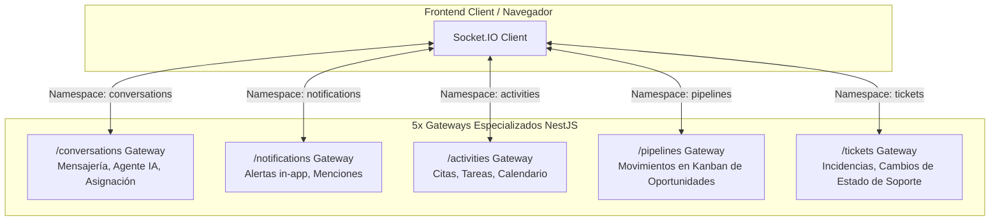

# 💬 Conversaciones, Webchat & Arquitectura WebSockets

## 1. Visión General de la Capa en Tiempo Real
CRM TIBS API adopta un diseño distribuido para eventos en vivo mediante **Socket.IO** (`@nestjs/websockets`, `@nestjs/platform-socket.io`), estructurado en **5 gateways independientes** para evitar la congestión de eventos y asegurar baja latencia en la interfaz de usuario.

---

## 2. Los 5 Gateways de WebSockets

### 2.1. Gateway de Conversaciones (`src/conversations/conversations.gateway.ts`)
* **Namespace:** `/conversations`
* **Transportes:** `websocket`, `polling` (con fallback automático).
* **Eventos Emitidos:**
  * `message_received`: Nuevo mensaje entrante de prospecto o emitido por el agente de IA / operador humano.
  * `bot_status_changed`: Notifica si el agente de IA ha sido encendido o apagado para esa conversación específica.
  * `conversation_assigned`: Notifica la asignación de un operador humano al chat.
  * `tenant_consumption_updated`: Notifica la actualización en tiempo real de los tokens consumidos por el inquilino (disparado vía listener desacoplado `@OnEvent(CONVERSATION_EVENTS.TENANT_CONSUMPTION_UPDATED)`).

### 2.2. Gateway de Notificaciones (`src/notifications/notifications.gateway.ts`)
* **Namespace:** `/notifications`
* **Propósito:** Envío instantáneo de alertas de sistema, recordatorios próximos a vencer, asignación de nuevas oportunidades o menciones internas entre colaboradores.
* **Seguridad & Autenticación:** Valida el Bearer JWT en el handshake (`client.handshake.auth.token`). La unión a la sala privada `user_${userId}` requiere verificación exitosa de firma contra `JWT_SECRET`, previniendo suscripciones no autorizadas a notificaciones de terceros.

### 2.3. Gateway de Actividades (`src/activities/activities.gateway.ts`)
* **Namespace:** `/activities`
* **Propósito:** Sincronización en vivo del calendario interno del CRM cuando un compañero de equipo crea, edita o completa una reunión o llamada.

### 2.4. Gateway de Pipelines (`src/pipelines/pipelines.gateway.ts`)
* **Namespace:** `/pipelines`
* **Propósito:** Actualización colaborativa del tablero Kanban de oportunidades. Cuando un ejecutivo arrastra una tarjeta a otra etapa, el cambio se refleja instantáneamente en las pantallas de los demás ejecutivos sin recargar la página.

### 2.5. Gateway de Tickets (`src/tickets/tickets.gateway.ts`)
* **Namespace:** `/tickets`
* **Propósito:** Refresco en tiempo real de la cola de soporte, notificación de tickets escalados por incumplimiento de SLA y nuevos comentarios de clientes.

---

## 3. Módulo de Webchat Público (`src/webchat`)

### 3.1. Widget Incrustable & Aislamiento Multi-Tenant
El módulo de webchat permite a los clientes de CRM TIBS integrar un widget de chat en vivo en sus sitios web y landing pages corporativas mediante un fragmento de JavaScript ligero (`widget.js`), manteniendo el aislamiento estricto por esquemas (*Database-Per-Schema*):
* **Identificación del Tenant (`tenantKey`):** El widget de la landing page envía en cada solicitud el UUID público del canal (`channel_configs.id`) o token verificado, evitando exponer el nombre del esquema PostgreSQL (`tenant_<slug>`).
* **Resolución con Caché LRU:** `ConversationsService.findTenantSchemaByWidgetKey(tenantKey)` localiza el inquilino en memoria (TTL de 300s con `@nestjs/cache-manager`) iterando `public.tenants` activos si no está en caché, con fallback directo por `schema_name`.
* `GET /api/webchat/public/init`: Valida el `tenantKey` recibido como query parameter o header `x-tenant-key`, comprobando la vigencia del canal para inicializar el widget externo.
* `POST /api/webchat/public/message`: Ingesta el mensaje del visitante (`SendPublicWebchatMessageDto`) ejecutado dentro de `TenantContextService.run({ tenantSchema }, ...)`. Si el visitante envía `email` o `phone`, enriquece o vincula automáticamente el prospecto en la tabla `clients` del tenant. Aplica el rate limiter de webhooks (`200 req/min`) y emite en vivo a los asesores comerciales vía WebSocket (`ConversationsGateway`).
* `GET /api/webchat/public/messages/:visitorId?tenantKey=...`: Devuelve el historial de mensajes de la conversación, datos del contacto y estado del bot (`botActive`).
* **Soporte de Landing Pages Externas y CORS Dinámico:** El backend autoriza dinámicamente orígenes web cruzados en `src/main.ts` para que los sitios web externos de los clientes puedan consumir la API sin bloqueos de navegador.

### 3.2. Handoff Humano-IA (Alternancia de Control)
* Por defecto, las conversaciones entrantes son atendidas por el Agente de IA (`bot_active = true`) con un debounce de 7 segundos (`scheduleAiReplyDebounce`), procesando con el prompt, subagentes y RAG vectorial exclusivo del esquema del inquilino.
* Un operador humano puede tomar el control de la conversación en cualquier momento mediante `PATCH /api/conversations/:id/bot-status` o respondiendo directamente desde la bandeja omnicanal del CRM (`POST /api/conversations/:id/messages`).
* Al apagarse el bot, el sistema silencia las respuestas del LLM y permite que el ejecutivo responda manualmente (`sender = 'user'`). Al responder, el mensaje se marca como entregado (`delivered`) y se visualiza de inmediato en el widget externo del visitante.

## 4. Asistente de Webchat Interno & Ejecución de Acciones (`WebchatActionExecutorService`)
El Webchat Interno asiste a ejecutivos y administradores para consultar métricas y ejecutar acciones operativas en lenguaje natural:
* **Flujos Multi-Turno:** Si una solicitud carece de parámetros indispensables (fecha, detalle, tipo de actividad o correo de contacto), el motor detiene la ejecución y solicita los datos pendientes conservando el contexto en turnos sucesivos.
* **Validación Obligatoria de Correo en Contactos:** Al programar actividades (`createActivity`) vinculadas a un contacto (`clientId`, `contacto` o `contactIds`), el sistema valida obligatoriamente que dicho contacto tenga un correo electrónico registrado en el CRM. Si carece de correo, el asistente solicita explícitamente el correo antes de agendar. Cuando el usuario proporciona el correo (en el mismo mensaje o en turnos sucesivos), el sistema actualiza y persiste el correo en el registro del contacto (`Client`) y completa la creación de la actividad automáticamente.
* **Modificación de Oportunidades y Cambio de Etapa (`modifyOpportunity`):** Permite actualizar montos, productos, catálogos, y mover oportunidades entre etapas del pipeline (`stage_id`) en lenguaje natural (ej. *"muevela a calificado"*, *"cambia a propuesta"*, *"pasa a negociación"*). Resuelve dinámicamente la etapa contra el catálogo real `tblstagescatalog` del pipeline mediante `resolveStage`, aplicando coincidencias semánticas e insensibles a mayúsculas/acentos, emitiendo la actualización en vivo por WebSocket (`PipelinesGateway`) y registrando la transición en `opportunity_trackings`.
* **Búsqueda Flexible y Resiliente de Oportunidades:** Búsqueda difusa y compacta que tolera diferencias de espacios (ej. *"redmagic"* coincide con *"Cotización Red Magic"*), palabras clave y búsqueda compuesta por nombre y apellido de clientes (`CONCAT(cliente.nombre, ' ', COALESCE(cliente.apellido, '')) ILIKE :hint`).
* **Fusión de Contexto Multi-Turno (`mergeHistoryContext`):** Si el usuario busca o consulta una oportunidad en un turno (ej. *"Cotización Red Magic"*) y en el turno siguiente simplemente ordena *"muevela a calificado"*, el sistema recupera la oportunidad de los mensajes previos (del usuario o de la respuesta del asistente) e inyecta la etapa de destino automáticamente.

## 5. Canales Externos (WhatsApp Cloud API, Meta, Instagram & Messenger)

### 5.1. Regla de Ventana de Atención (24h con Margen de Seguridad de 23 Horas)
Meta impone en WhatsApp Cloud API la *Customer Service Window* de 24 horas a partir del último mensaje entrante del cliente (`lastCustomerMessageAt`).
Para evitar fallos de entrega silenciosos y rechazos de Meta en tránsito (Error `#131047: Re-engagement message`), CRM TIBS API aplica una política preventiva con **margen de seguridad de 23 horas** (`WHATSAPP_WINDOW_HOURS_MARGIN = 23`):
* `isCustomerWindowActive(23)`: Evalúa si la conversación está dentro del margen seguro de 23 horas.
* **Bloqueo Preventivo:** Si la ventana expiró, el endpoint `POST /api/conversations/:id/messages` rechaza mensajes de texto libre con HTTP `400 Bad Request` (`code: 'WHATSAPP_24H_WINDOW_EXPIRED'`), evitando guardar mensajes no entregados en la base de datos.
* **Enriquecimiento de Listas:** `GET /api/conversations` devuelve para cada conversación `is24HourWindowActive`, `windowExpiresAt` y `safetyWindowExpiresAt`.

### 5.2. Plantillas Oficiales de Meta (WhatsApp Message Templates)
* `GET /api/conversations/:id/templates`: Retorna **únicamente la plantilla base configurada** (con su `id` oficial de Meta, `name` y componentes `BODY`), evitando sobrecargar al operador con plantillas ajenas al inicio de chat. Admite `?all=true` para consultar el catálogo completo de Meta si fuera necesario.
* `POST /api/conversations/:id/template-message`: Envía una plantilla pre-aprobada (`type: 'template'`) con sus componentes/variables a Meta Graph API. Registra el mensaje en la tabla `messages` con `messageType: 'template'`, `status: 'sent'`, el `wamid` devuelto por Meta, y almacena en `content` el **texto real e interpolado de la plantilla** (con sus variables sustituidas, encabezado y pie de página), garantizando que la burbuja del chat muestre el mensaje legible y exacto enviado al cliente.

### 5.3. Rastreo de Estados de Entrega (Webhooks `statuses`)
* La tabla `messages` incluye `status` (`'pending' | 'sent' | 'delivered' | 'read' | 'failed'`), `messageType`, `externalMessageId` (`wamid`) y `errorMessage`.
* `ConversationsService.handleIncomingWebhook`: Procesa las notificaciones de estado de Meta (`value.statuses`), actualiza el registro en la base de datos del tenant y emite en tiempo real a los navegadores mediante el WebSocket Gateway (`message_status_updated`).

### 5.4. Plantilla Base de Inicio y Sincronización Directa con Meta Graph API
Para iniciar conversaciones o reabrir el canal tras la expiración de la ventana de 23h, CRM TIBS implementa el concepto de **Plantilla Base** persistida en la tabla dedicada `whatsapp_templates`:
* **Tabla `whatsapp_templates`:** Guarda las plantillas vinculadas a cada configuración de canal (`channelConfigId`), con `templateId` (Meta ID), `name` (estrictamente inmutable: `crm_inicio_conversacion`), `category` (`'MARKETING'`), `language` (`'es'`), `bodyText` (por defecto `'Hola {{1}}, ¿cómo estás? Me comunico contigo para dar seguimiento y revisar lo siguiente:'`), `status` (`'APPROVED' | 'PENDING' | 'REJECTED'`) y la bandera `isBase = true`.
* **Soporte de Variables Estrictamente Delimitado (Máximo 3):**
  * `{{1}}`: Nombre del contacto o cliente (`client.nombre` o `conversation.clientName`).
  * `{{2}}`: Nombre de la empresa asociada al contacto en el CRM (`client.company.nombre` o `client.empresa`, ej. *"TIBS MX"*). Si el contacto no tiene empresa vinculada, se resuelve y envía **vacío** (con sanitización transparente para evitar errores de parámetro vacío en Meta Graph API).
  * `{{3}}`: Nombre del asesor, ejecutivo de cuenta o usuario logueado (`client.ejecutivo.username` o `user.username`).
  * La API valida que las variables sean estrictamente correlativas y no permite más de 3 variables.
* **Edición con Impacto Directo en Meta:**
  * `PUT /api/conversations/channels/:channelConfigId/base-template`:
    * **Restricción estricta de campos:** Solo permite modificar `headerText`, `bodyText` y `footerText`. El nombre técnico es obligatorio e inmutable (`crm_inicio_conversacion`) de acuerdo a las directivas de Meta.
    * Si la plantilla ya tiene `templateId`: envía `POST https://graph.facebook.com/v19.0/{templateId}` con los nuevos componentes (`BODY`, `HEADER`, `FOOTER`).
    * Si es nueva: envía `POST https://graph.facebook.com/v19.0/{wabaId}/message_templates` con nombre `crm_inicio_conversacion`, categoría `MARKETING`, idioma `es` y componentes con ejemplos dinámicos realistas (`Juan Pérez`, `TIBS MX`, `Carlos Asesor`). Guarda el ID oficial retornado por Meta.
  * `GET /api/conversations/channels/:channelConfigId/base-template`: Consulta la plantilla base del canal y sincroniza en vivo su estado (`status`), componentes y categoría (`MARKETING`) desde Meta Graph API.
  * `POST /api/conversations/channels/:channelConfigId/select-base-template`: Permite asignar una plantilla aprobada preexistente en Meta como la plantilla base del canal.
* **Uso en Conversación:**
  * `GET /api/conversations/:id/base-template`: Obtiene la plantilla base y resuelve dinámicamente las 3 variables con los datos reales del contacto (`resolvedVariables`: `1` -> contacto, `2` -> empresa del contacto o `""`, `3` -> ejecutivo/asesor).
  * `GET /api/conversations/:id/templates`: Retorna exclusivamente la plantilla base con su ID de Meta.
  * `POST /api/conversations/:id/template-message`: Si no se pasan componentes explícitos, autocompleta automáticamente las variables con el nombre del contacto, la empresa vinculada al contacto (`TIBS MX` o vacía si no existe) y el asesor asignado. Sanitiza parámetros vacíos para que Meta Graph API nunca falle con código 100.

##### 5.5. Enriquecimiento en Vivo de Metadatos de Canales (`GET /api/conversations/channels`)
Para asegurar la total alineación con Meta App Review y la visualización de activos en la UI:
- `findChannels()` consulta en vivo a Meta Graph API (`v19.0`) con timeout seguro (`AbortSignal.timeout(4000)`) y resiliencia ante errores:
  - **Instagram:** Consulta `fields=username,name,profile_picture_url` devolviendo `igUsername` y `metaProfileName` (ej. `@tibsbilly`).
  - **Facebook / Messenger:** Consulta `fields=name,id,picture` con fallback a `/me`, retornando `fbPageName`.
  - **WhatsApp:** Consulta `fields=verified_name,display_phone_number` retornando `waVerifiedName`.
- Retorna el objeto enriquecido con propiedades de primer nivel (`igUsername`, `fbPageName`, `waVerifiedName`, `metaProfileName`, `metaDetails`).

### 5.6. Facebook Login for Business & Meta OAuth2 (`MetaOauthService`)
Para eliminar la necesidad de configuración manual de credenciales (App ID, Page ID, token permanente y webhook verify token) por parte de los clientes:
* **Flujo OAuth2 Centralizado con Aislamiento Multi-Tenant:**
  * `GET /api/conversations/oauth/facebook/auth-url`: Genera la URL oficial de autorización de Meta (`https://www.facebook.com/v19.0/dialog/oauth`) codificando en el parámetro `state` el `tenantSchema`, `userId` y timestamp en Base64.
  * Scopes solicitados: `pages_show_list`, `pages_manage_metadata`, `pages_messaging`, `instagram_basic`, `instagram_manage_messages`, `public_profile`.
* **Canje, Auto-Suscripción y Verificación Estándar:**
  * `GET /api/conversations/oauth/facebook/callback`:
    1. Decodifica el `state` y extrae el `tenantSchema`.
    2. Canjea el código de autorización por un token de usuario y luego por un `Long-Lived User Access Token` (60 días).
    3. Consulta `GET /me/accounts` obteniendo las Páginas administradas y sus cuentas de Instagram Business vinculadas (`instagram_business_account`).
    4. Auto-suscribe automáticamente la página seleccionada a los Webhooks de Meta mediante `POST /{page-id}/subscribed_apps?subscribed_fields=messages,messaging_postbacks`.
    5. Usa la verificación por defecto `'meta_oauth_auto'` (`verifyMetaWebhook`) sin requerir variables en `.env`.
    6. Normaliza las consultas de credenciales de canal en TypeORM (`In(['facebook', 'messenger'])`) para asegurar que el canal `'messenger'` y `'facebook'` utilicen las mismas credenciales activas del tenant, resolviendo envíos de salida en tiempo real.
    7. Ejecuta la persistencia dentro de `TenantContextService.run({ tenantSchema }, ...)` para registrar o actualizar los registros en `channel_configs` (canal `facebook` y canal `instagram`).
    8. Responde con `renderPopupResponse`: emite `window.opener.postMessage({ type: 'META_OAUTH_SUCCESS' })` y cierra la ventana emergente automáticamente.

### 5.7. Capa Semántica: Resolución de Rangos Temporales e Intervalos Dinámicos (`WebchatCubeExecutorService`)
Para garantizar que las consultas analíticas en lenguaje natural sobre intervalos temporales pasados o futuros no colapsen en un solo día:
* **Semanas Dinámicas (`hace N semanas`, `semana antepasada`, `en N semanas`):**
  * Se calcula el rango completo de lunes a domingo `[targetMonday, targetSunday]` en lugar de evaluar una fecha puntual `-(N * 7)`.
  * Sintoniza términos coloquiales como `"la semana antepasada"`, `"semana antepasada"` (equivalente a $N = 2$) y días relativos de semanas pasadas (`"el viernes de la semana antepasada"`).
* **Meses y Años Dinámicos (`hace N meses`, `mes antepasado`, `hace N años`):**
  * `hace N meses` y `el mes antepasado`: Generan el intervalo completo del mes calendario desde el primer día (`YYYY-MM-01`) hasta el último día del mes (`YYYY-MM-lastDay`).
  * `hace N años` y `el año antepasado`: Generan el intervalo anual completo (`YYYY-01-01` a `YYYY-12-31`).
* **Sincronización con el Router LLM (`WebchatPromptBuilderService`):**
  * La instrucción crítica de fechas especifica el uso de `This week`, `Last week`, `hace 2 semanas`, `hace 2 meses` y `hace 2 años`, asegurando que el ejecutor reciba expresiones que Cube.dev resuelva con exactitud para la zona horaria del tenant (`America/Mexico_City`).

### 5.8. Interpolación Robusta de Plantillas de Respuesta (`WebchatResponseFormatterService`)
* **Soporte de Placeholders Vacíos y Posicionales:**
  * Detecta y sustituye llaves vacías `{}` generadas por modelos LLM (estilo Python format) con el valor de la medida principal (`Actividades.count`, etc.) o secuencialmente según la lista de columnas.
  * Soporta índices posicionales (`{0}`, `{1}`) y alias semánticos comunes (`{total}`, `{count}`, `{cantidad}`, `{resultado}`, `{valor}`, `{monto}`).
  * Limpia cualquier llave residual no resuelta (`/\Rule\{[a-zA-Z0-9_.]*\}/g`) para evitar que se muestren corchetes `{}` en la interfaz de usuario.

### 5.9. Ejecución de Acciones: Agendamiento de Actividades, Días Relativos y Recordatorios (`WebchatActionExecutorService`)
* **Resolución Temporal Inmune a Substring Matches (`parseNaturalDate`):**
  * `pasado mañana` se evalúa strictly antes que `mañana` para evitar que la coincidencia por subcadena colapse una cita a +1 día en vez de +2 días.
  * Aislamiento de horas frente a días de mes (`4 de octubre a las 3 pm` no confunde el día `4` con la hora).
  * Aislamiento de textos de recordatorio (`a las 3 pm con recordatorio a la 1 pm` preserva `3 pm` para la actividad y `1 pm` para el recordatorio).
  * Función `buildDateInTz(year, month, day, hour, minute)` inmune a desfases en límites de mes y cambios de horario en `America/Mexico_City`.
* **Recordatorios Personalizados y Tolerancia a Errores Tipográficos:**
  * Soporta horas específicas (`"con recordatorio a la 1 pm"`, `"a las 13:00"`), diferencias relativas (`"2 horas antes"`), `"misma hora"` y errores tipográficos comunes (`"reordatorio"`).
  * Asigna la fecha del recordatorio calculada en el mismo día de la actividad en la zona horaria del CRM.
* **Resolución Dinámica de Tipos de Actividad (`resolveTypeActivity`):**
  * Detecta el tipo tanto desde parámetros explícitos como desde el texto descriptivo de la acción (`Demostración`, `Reunión`, `Llamada`, `Visita`), validando contra el catálogo activo en el esquema del tenant (`tbltypeactivities`).

### 5.10. Resolución Resiliente de Perfiles de Facebook Messenger (Fallback por Fan Page)
* **Reto:** En versiones recientes de Meta Graph API, la consulta directa de nodos PSID (`GET /{PSID}?fields=first_name,last_name`) devuelve `error_code: 100, error_subcode: 33` si la App de Meta no ha completado el proceso de revisión pública o restringe perfiles.
* **Estrategia Resiliente en `ConversationsService`:** Si la consulta directa al PSID no entrega el nombre, el sistema ejecuta de forma automática e inmediata un fallback consultando los participantes de la conversación mediante el endpoint de la Fan Page:
  `GET /v19.0/{page_id}/conversations?user_id={senderId}&fields=participants`
* **Auto-actualización de Entidades:** Extrae el participante coincidente de la lista (`participant.name`), asigna el nombre real a `conversation.clientName` y actualiza automáticamente el registro `client.nombre` en la base de datos del tenant, garantizando que el contacto deje de mostrarse como *"Usuario de Facebook"*.

### 5.11. Soporte de Notas de Voz y Audios (IBM Watson Speech to Text & Respuesta IA)
* **Arquitectura de Transcripción (`SpeechToTextService`):**
  * Servicio desacoplado en `src/conversations/speech-to-text.service.ts` conectado a la instancia oficial de **IBM Watson Speech to Text** (`us-south`).
  * Autenticación HTTP Basic directa (`Authorization: Basic base64('apikey:' + apiKey)`), reduciendo sobrecarga de SDKs externos.
  * Modelo predeterminado: `es-MX_BroadbandModel` (Español de México, banda ancha) con fallback configurable por variable de entorno `IBM_SPEECH_TO_TEXT_MODEL`.
* **Descarga y Persistencia Física de Audios (`StorageService.saveBuffer`):**
  * **WhatsApp:** Procesa webhooks con `message.type === 'audio'`. Consulta metadata en Graph API `GET /v19.0/{audioId}` para obtener URL temporal de `lookaside.fbsbx.com` y descarga el búfer binario en formato `audio/ogg;codecs=opus`.
  * **Messenger & Instagram:** Detecta `messaging.message.attachments` con `type === 'audio'`. Descarga el búfer de audio directamente desde la URL del CDN de Meta (`audio/mp4`, `audio/aac`).
  * **Almacenamiento Físico Inmutable:** El archivo de audio se persiste automáticamente mediante `StorageService.saveBuffer` en `uploads/conversations/audios/${timestamp}_${mediaId}.${ext}` (compatible de forma nativa con Local Storage y Azure Blob Storage).
  * **Endpoint de Streaming:** `GET /api/conversations/media/:filename` permite reproducir o descargar audios con soporte de headers de rango HTTP para scrubbing y reproducción fluida en cualquier navegador.
* **Modelo Híbrido: Persistencia Omnicanal + Transcripción IA:**
  * El mensaje se persiste en la tabla `messages` con `messageType: 'audio'`, `mediaUrl` (URL del archivo), `mediaMimeType` y `content: transcriptText`.
  * **Atención Humana (Bot Apagado):** El asesor comercial cuenta con el archivo de audio reproducible directamente en el módulo de conversaciones, eliminando la dependencia ciega de la transcripción.
  * **Atención Automatizada (Bot Activo):** Se programa el debounce de 7 segundos (`scheduleAiReplyDebounce`). Si el usuario no envía más mensajes en esa ventana, `triggerAiReply` recupera el texto transcrito de `content` y lo entrega al motor agéntico (`AiAgentOrchestratorService`) para generar la respuesta contextual.
  * Se emite en vivo a los asesores mediante `ConversationsGateway` (`message_received`) con todos los metadatos multimedia.

### 4.1. Sincronización en Tiempo Real de Acciones en la UI (WebSockets Multi-Tenant)
Para garantizar que cualquier acción ejecutada desde el Webchat Interno (crear/modificar oportunidades, programar actividades o levantar tickets) se refleje instantáneamente en las pantallas activas del CRM (Tablero Kanban de Pipeline, Calendario de Actividades, Helpdesk) sin requerir recargar la página (F5):
* **Preservación Íntegra de la Entidad `User`:**
  * `WebchatController` recibe `@GetUser() user: User` y lo transfiere intacto a través de `WebchatService.processQuery` y `WebchatActionExecutorService.executeAction`.
  * Los métodos de creación y actualización (`opportunitiesService.create`, `opportunitiesService.update`, `activitiesService.create`, `activitiesService.update`, `ticketsService.create`, `ticketsService.update`) reciben la entidad de usuario completa en lugar de objetos podados `{ id: user.id } as User`.
  * Esto asegura que los historiales de interacciones, notificaciones internas y auditorías atribuyan la autoría al usuario y asesor real, en vez de registrar al usuario como `"Sistema"`.
* **Resolución Explícita del Esquema del Tenant (`resolvedTenant`):**
  * Para prevenir que llamadas en segundo plano o el contexto asíncrono (`AsyncLocalStorage`) se degraden o resuelvan el esquema base `'public'` (especialmente en sesiones de rol SuperAdmin o llamadas encadenadas con LLMs), los servicios de dominio computan el esquema objetivo de forma jerárquica:
    `const resolvedTenant = (user as any)?.tenant?.schema_name || (typeof (user as any)?.tenant === 'string' && (user as any)?.tenant !== 'public' ? (user as any).tenant : TenantContextService.getTenantSchema());`
  * Este `resolvedTenant` se envía como argumento explícito a las funciones emisoras de los gateways (`emitOpportunityCreated`, `emitOpportunityUpdated`, `emitOpportunityDeleted`, `emitActivityCreated`, `emitActivityUpdated`, `emitActivityDeleted`, `emitTicketCreated`, `emitTicketUpdated`, `emitTicketDeleted`).
* **Enrutamiento Estricto y Auditoría de Salas en Gateways:**
  * En `PipelinesGateway`, `ActivitiesGateway` y `TicketsGateway`, el método `getTargetRoom(tenantSchema)` prioriza el esquema explícito validado, vinculando la emisión a la sala aislada `tenant:${tenantSchema}`.
  * Previene activamente la fuga de datos (*Cross-Tenant Data Leakage*) bloqueando emisiones involuntarias a `tenant:public`.
  * Se integran trazas de registro estructuradas (`this.logger.log`) para auditar en tiempo real el envío de eventos hacia los clientes de Socket.IO conectados en el frontend.

### 4.2. Resolución Ortográfica, Desempate Semántico y Clarificación de Ambigüedad
Para evitar tanto fallos por errores ortográficos/tildes como falsos positivos destructivos al modificar datos en el CRM:
* **Resolución Insensible a Tildes y Caracteres Diacríticos:**
  * Las búsquedas en `WebchatActionExecutorService` utilizan la función inmutable de base de datos `public.f_unaccent_immutable(texto)`, respaldada por el índice B-tree `idx_opportunities_nombre_norm` creado en todos los esquemas (`public` y `tenant_*`).
  * Permite que consultas de texto plano (ej. `"cotizacion 4"`) coincidan determinísticamente con registros titulados con tildes (ej. `"Cotización 4"`).
* **Desempate Semántico con Damerau-Levenshtein y Ponderaciones:**
  * Se implementa `rankEntitiesByRelevance` en `webchat-entity-ranker.util.ts` para evaluar similitud de cadena completa, inclusión de subcadenas, palabras clave y tolerancia a erratas tipográficas.
* **Confirmación Interactiva ante Ambigüedad:**
  * Si se encuentran múltiples candidatos con puntajes cercanos ($\Delta < 1500$), el Webchat no adivina ni ejecuta la modificación a ciegas. En su lugar, responde solicitando confirmación al usuario y listando las opciones encontradas con sus metadatos clave (nombre, cliente/empresa, monto y etapa).

### 5.12. WhatsApp Embedded Signup (Conexión Simplificada On-Behalf-Of)
Para homologar la experiencia de usuario con la conexión simple de Facebook e Instagram, se implementa la integración nativa con **Meta WhatsApp Embedded Signup**:
* **Endpoints de Soporte en `ConversationsController` y `MetaOauthService`:**
  * `GET /api/conversations/oauth/meta-config`: Expone dinámicamente al frontend el `appId` y el `whatsappConfigId` (`META_WHATSAPP_CONFIG_ID`) registrados en Meta for Developers, evitando duplicación y desincronización de credenciales.
  * `POST /api/conversations/oauth/whatsapp/embedded-callback`: Ingesta el payload de `ConnectWhatsAppEmbeddedDto` (`code`, `wabaId`, `phoneNumberId` y `name`).
* **Flujo Automatizado de Alta:**
  1. Canjea en vivo el código temporal de autorización por un token de acceso mediante `POST https://graph.facebook.com/v19.0/oauth/access_token`.
  2. Auto-suscribe automáticamente la WABA a los Webhooks de la App mediante `POST https://graph.facebook.com/v19.0/{wabaId}/subscribed_apps` con autorización Bearer.
  3. Consulta metadata en Graph API `GET /{phoneNumberId}?fields=verified_name,display_phone_number` para nombrar amigablemente la cuenta en el CRM.
  4. Valida unicidad multi-tenant mediante `checkAssetConflictInOtherTenants('whatsapp', phoneNumberId, tenantSchema)` para impedir colisiones entre empresas.
  5. Persiste el canal en `channel_configs` del tenant con `verifyToken = 'meta_oauth_auto'` e `isActive = true`.
  6. Garantiza la existencia e inicialización de la plantilla base `crm_inicio_conversacion` (`isBase = true`), asegurando que el envío outbound y la ventana de 23 horas queden listos de inmediato para operar.

* **Estrategia de Persistencia de Tokens Permanentes:**
  * Al vincular la cuenta mediante Embedded Signup, el backend canjea el código de autorización por un `Long-Lived User Access Token`.
  * Además, `MetaOauthService.connectWhatsAppEmbedded` prioriza la variable `META_SYSTEM_USER_TOKEN` / `META_PERMANENT_SYSTEM_USER_TOKEN`. Si está presente en `.env`, el canal se vincula con el token permanente del usuario del sistema central de la plataforma, asegurando inmunidad total a revocaciones o expiraciones de sesión personal de Facebook del usuario.
