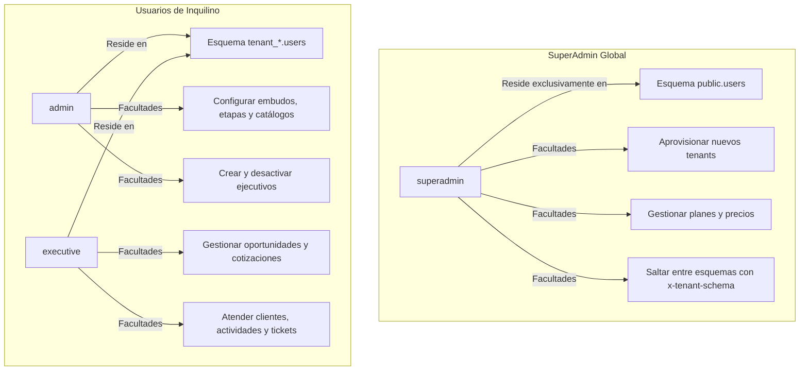

# 👥 Gestión de Usuarios, Roles & Permisos en CRM TIBS API

## 1. Modelo de Control de Acceso Basado en Roles (RBAC)
CRM TIBS API define tres roles jerárquicos tipados a través de `Role` (`src/role.enum.ts`), cuya ubicación física y facultades están estrictamente segregadas para preservar el aislamiento multi-inquilino:



### 1.1. Matriz de Permisos por Rol

| Capacidad / Recurso | `superadmin` | `admin` (Tenant) | `executive` (Tenant) |
| :--- | :---: | :---: | :---: |
| **Aprovisionar tenants y crear esquemas** | ✅ | ❌ | ❌ |
| **Administrar catálogo de planes SaaS** | ✅ | ❌ | ❌ |
| **Modificar cuotas y renovaciones de tenants** | ✅ | ❌ | ❌ |
| **Cambiar de inquilino vía `x-tenant-schema`** | ✅ | ❌ | ❌ |
| **Crear y editar usuarios del propio inquilino**| ❌ | ✅ | ❌ |
| **Configurar pipelines, etapas y helpdesks** | ❌ | ✅ | ❌ |
| **Gestionar oportunidades comerciales propias/equipo**| ❌ | ✅ | ✅ |
| **Generar y enviar cotizaciones PDF** | ❌ | ✅ | ✅ |
| **Atender tickets de soporte técnico** | ❌ | ✅ | ✅ |
| **Sincronizar calendario personal (Google/MS)**| ❌ | ✅ | ✅ |

---

## 2. Aislamiento Físico de SuperAdmins vs Usuarios de Inquilino
Una de las reglas de oro de la arquitectura es que **ningún usuario con rol `superadmin` puede residir en el esquema de una organización**:
1. Los registros de SuperAdmin se almacenan únicamente en la tabla `public.users`.
2. Cuando `TenantMiddleware` procesa una petición dirigida a un inquilino, ejecuta una consulta de saneamiento defensiva:
   ```sql
   DELETE FROM "${tenantSchema}".users WHERE LOWER(role::text) = 'superadmin';
   ```
3. Esto garantiza que si una brecha o inyección local intentara elevar privilegios dentro de un tenant, el usuario no podrá heredar privilegios de administración de la plataforma completa.

---

## 3. Administración de Usuarios (`src/users`)

### 3.1. Creación de Usuarios (`POST /api/users`)
* Requiere rol autenticado vía JWT.
* Valida unicidad de `username` y `email` en el esquema activo.
* Hashea la contraseña con `bcrypt.hash(password, 10)`.
* Permite asignar el rol `executive` o `admin`. Se prohíbe la auto-asignación de `superadmin` en rutas de tenant.

### 3.2. Actualización de Estado (`PATCH /api/users/:id/status`)
* Permite a un administrador suspender el acceso de un colaborador (`isActive: false`) sin eliminar su histórico comercial (oportunidades cerradas, tickets atendidos, interacciones y llamadas).
* La desactivación invalida inmediatamente cualquier intento de nuevo login en `AuthService.validateUser()`.

### 3.3. Subida de Fotos de Perfil (`POST /api/users/:id/profile-image`)
* Utiliza `FileInterceptor('file')` con la fábrica compartida `createDiskMulterOptions` (`src/common/utils/upload.util.ts`) en modo `'image'` (solo `.png`, `.jpg`, `.jpeg`, `.webp`, `.gif`; máx. `10 MB`) y validación anti-traversal en `:id` (`assertSafeUploadParamId`).
* Sanea el nombre de archivo con `sanitizeUploadFilename()` (`${Date.now()}-${nombre_saneado}.${ext}`), eliminando espacios, acentos y caracteres especiales.
* Almacenamiento agnóstico mediante `StorageService.uploadFile()`:
  * Si `STORAGE_TYPE === 'azure'`, el archivo se sube a Azure Blob Storage en `uploads/users/:userId/:filename` enviando `blobHTTPHeaders.blobContentType` inferido y eliminando el archivo temporal local.
  * Si `STORAGE_TYPE === 'local'`, se almacena en el directorio `./uploads/users/:userId/`.
* Normaliza las barras de ruta para compatibilidad entre sistemas operativos Windows y Linux (`path.replace(/\\\\/g, '/')`), actualiza `profileImageUrl` y elimina la foto previa mediante `StorageService.deleteFile()`.


### 3.4. Almacenamiento Agnóstico en Usuarios, Tenants y Gastos (`StorageService`)
* **Migración a `StorageService` (Local / Azure Blob Storage) y reglas de `upload.util.ts`:**
  * **Utilidades compartidas (`src/common/utils/upload.util.ts`):** Centraliza saneamiento de nombres (`sanitizeUploadFilename`), filtros MIME/extensión (`createMulterFileFilter`), límites por módulo (`createDiskMulterOptions`), inferencia de `Content-Type` (`inferMimeTypeFromPath`) y decodificación segura anti-traversal (`decodeSafeUploadPath`).
  * **Usuarios (`UsersController` / `UsersService`):** `POST /api/users/:id/profile-image` usa modo `'image'` (máx. 10 MB, con timestamp), delega en `usersService.uploadProfileImageFile()`, sube a Azure con `blobHTTPHeaders.blobContentType` cuando `STORAGE_TYPE=azure` y elimina la imagen anterior vía `StorageService.deleteFile()`.
  * **Tenants (`TenantsController` / `TenantsService`):** `POST /api/tenants/:id/logo` usa modo `'image_with_svg'` (`.png/.jpg/.jpeg/.webp/.gif/.svg/.bmp/.tiff`, máx. 10 MB, nombre `logo_${timestamp}.${ext}` con extensión saneada) y delega en `tenantsService.uploadLogoFile()`.
  * **Gastos (`ExpensesController` / `ExpensesService`):** `POST /api/expenses/:id/receipt`, `DELETE /api/expenses/:id/receipt`, `DELETE /api/expenses/:id` y `GET /api/expenses/:id/receipt/download` usan modo `'receipt'` (imágenes y `.pdf`, máx. 15 MB, con timestamp) y operan de forma agnóstica con `StorageService`.
  * **Productos y Oportunidades (`ProductsModule`, `OpportunitiesModule`):** Productos aplica resolución dinámica (`'image'` en `/cover-image`, `'document_or_image'` en `/files`, máx. 20 MB); Oportunidades aplica `'document_or_image'` (máx. 20 MB, bloqueando ejecutables/scripts/HTML/SVG).
  * **Middleware de fallback en `src/main.ts` (`/uploads` y `/backend/uploads`):** Decodifica rutas URL-encoded (`%20`, etc.) con `decodeSafeUploadPath()`, bloquea traversal `..` y establece `Content-Type` desde `inferMimeTypeFromPath()` al servir archivos locales o transmitir blobs desde Azure.

### 3.5. Endurecimiento RBAC, Validación y Parcheo Seguro en `UsersController` / `UsersService`
* **Control de Roles en Endpoints:** `POST /api/users` y `PATCH /api/users/:id/status` exigen rol `Admin` o `SuperAdmin`. `PATCH /api/users/:id` y `POST /api/users/:id/profile-image` restringen a `Executive` a editar únicamente su propio registro sin alterar `role` ni `isActive`.
* **Bloqueo de Escalamiento a `superadmin`:** `UsersService.create()` y `UsersService.update()` prohíben crear o promover cuentas con rol `superadmin` cuando el contexto activo es un esquema tenant.
* **Actualizaciones Parciales (`PATCH`):** `UsersService.update()` construye cláusulas `SET` dinámicas solo para los campos presentes (`!== undefined`), omitiendo `password` vacío en `UpdateUserDto` para evitar sobrescritura de columnas `NOT NULL` o degradación accidental de rol.
* **Resolución de Recuperación y Aislamiento:** `findOneByResetToken()` permite explícitamente el esquema `public` para SuperAdmins (antes omitido por `RESERVED_SCHEMAS`), y todas las interpolaciones `"${tenantSchema}"` validan previamente `TenantContextService.validateSchemaName()`.
* **Validación de Parámetros y Límites:** Todos los `:id` del controlador aplican `ParseUUIDPipe`; `CreateUserDto` acota `username` (`<=100`), `email` (`<=255`), `password` (`8..72` letras+números) y `profileImageUrl` (`<=500`).
